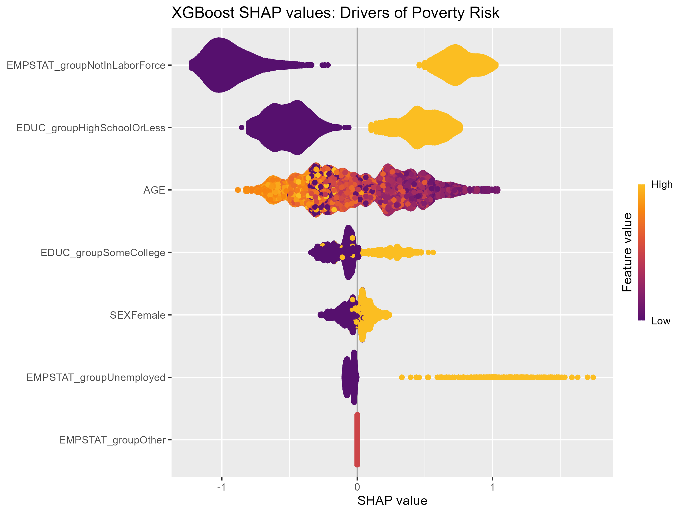

## Introduction

Poverty is a persistent feature of the U.S. labor market, affecting roughly 11% of adults in any given year. While economists have long studied the structural drivers of poverty—such as education and employment status—less attention has been paid to whether we can *predict* who is at risk at the individual level. Accurate prediction is practically useful: it allows social safety net programs to proactively target resources to those who need them most.

This analysis uses microdata from the **IPUMS Current Population Survey (CPS)** to build a complete machine learning workflow. I compare a simple logistic regression benchmark against Random Forest and XGBoost to predict whether an adult falls below the official poverty line. 

The headline result: **Machine learning offers a modest but meaningful improvement over the baseline**, and its true value lies in *targeting*. By identifying the top 20% highest-risk individuals, the model locates a subgroup where the poverty rate is **25.4%**—more than double the national average of 10.4%.

## How I Measured It

I used the 2024 Annual Social and Economic Supplement (ASEC) of the CPS, which contains detailed annual income and demographic data.

To avoid data leakage, I strictly excluded current wage income (`INCWAGE`) since the poverty line is mechanically defined by income. The predictors include:
- Age (`AGE`)
- Sex (`SEX`)
- Education, binned into three groups: high school or less, some college, and bachelor's plus.
- Employment status, binned into three groups: employed, unemployed, and not in the labor force.

The data is split 80/20 into training and test sets. Because the poverty rate is only 10.4%, accuracy is a misleading metric (a naive model predicting "no poverty" for everyone would be 89.6% accurate). Instead, I evaluate models primarily using **ROC-AUC** and a targeted policy metric: the actual poverty rate within the 20% of individuals assigned the highest predicted risk.

I compare three models: Logistic Regression (Baseline), Random Forest, and XGBoost. Hyperparameters for the tree models are tuned using cross-validation on the training set, ensuring the test set remains completely unseen until final evaluation.

## Finding 1: ML Improves Targeting Capability

| Model | AUC | Top 20% Poverty Rate | Overall Poverty Rate |
| :--- | :---: | :---: | :---: |
| Logistic (Baseline) | 0.740 | 23.7% | 10.4% |
| Random Forest | 0.755 | 23.7% | 10.4% |
| XGBoost | 0.765 | 25.4% | 10.4% |

The results reveal that machine learning offers a modest but real improvement over the baseline. The logistic regression performs surprisingly well, achieving an AUC of 0.740. However, the gradient boosting model (XGBoost) outperforms it, reaching an AUC of **0.765**.

The more practical metric is the "Targeting" performance. While the overall poverty rate in the test set is 10.4%, the 20% of individuals with the highest predicted risk from XGBoost have an actual poverty rate of **25.4%**. For a policymaker, this means ML can sharply focus limited resources on the most vulnerable groups instead of random selection.

## Finding 2: Labor Force Detachment is the Biggest Risk

{width=90%}

To understand *what* the XGBoost model learned, I compute SHAP (SHapley Additive exPlanations) values on the test set. SHAP values decompose each individual's prediction, showing how much each feature pushed the predicted probability of poverty up or down.

The beeswarm plot provides an intuitive story:
- **Labor force status** is the most powerful driver. Being "Not in the Labor Force" (yellow dots on the right) drastically increases the risk of poverty.
- **Education** is the second key factor. Having a high school education or less strongly increases risk, whereas having "some college" or a bachelor's degree strongly protects against poverty (purple dots on the left).
- **Age** displays a non-linear relationship. Younger individuals have a higher risk, which gradually declines as they approach prime working age.

Interestingly, while being "Unemployed" is a massive shock that pushes risk sky-high, "Not in the Labor Force" has a broader, more consistent impact across the sample. This highlights a distinct form of vulnerability: people who have stopped looking for work are structurally more likely to be in poverty than those who are actively unemployed.

## Conclusion

This machine learning workflow yields three takeaways:

1. **Predicting poverty is tractable, but the performance ceiling is modest.** Complex models (XGBoost) outperform simple ones (AUC 0.765 vs 0.740), but the gain isn't magical.
2. **Predictive gains are practically valuable when used for targeting.** The model successfully identifies a high-risk subgroup where poverty is 2.4 times more prevalent.
3. **Interpretability tools like SHAP reveal structural truths.** Structural detachment from the labor force, rather than temporary unemployment, is the strongest risk factor. Machine learning will not replace economists' structural models, but it provides a powerful lens for identifying who needs help the most.

## Limitations

This analysis has several limitations:

- **Observational, not causal.** The model identifies predictive correlations, not the causal effect of education or employment on poverty. 
- **Limited features.** The model relies on a small set of demographic and labor force variables. Adding geographic, health, or household structure data could improve predictive power.
- **Threshold-based evaluation.** While the Top-20% targeting reflects a realistic policy constraint, the optimal percentage might vary depending on the actual budget of the welfare program.

---

*Data source: [IPUMS CPS](https://cps.ipums.org/), Annual Social and Economic Supplement, 2024. Full code and data are available in the project repository.*