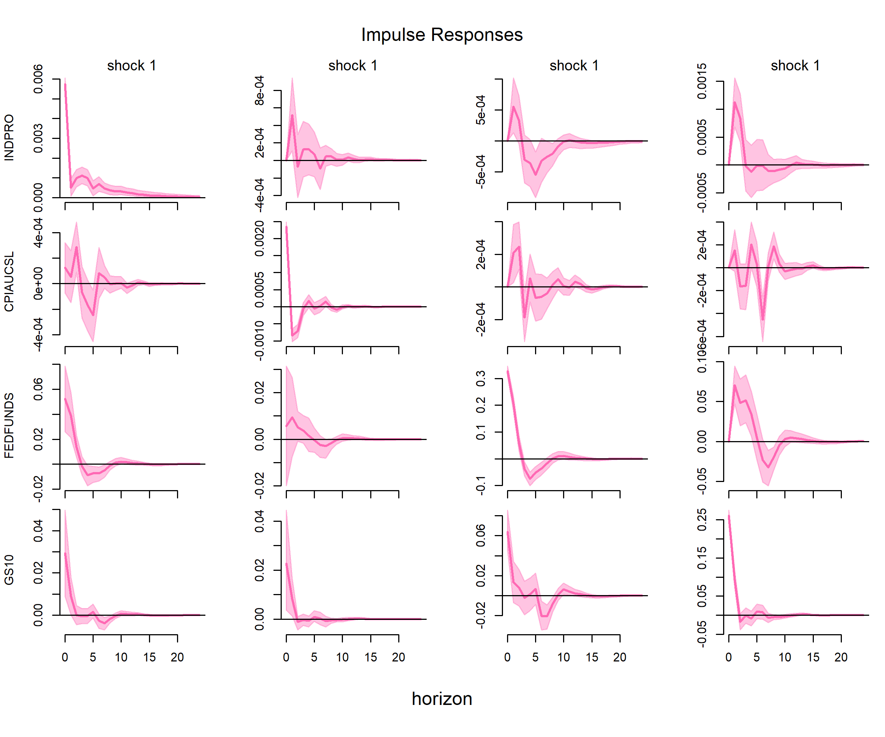

## Introduction

When the Federal Reserve raises interest rates, how quickly does the real economy slow down? Does inflation respond immediately, or with a lag? These questions are central to monetary policy, yet answering them requires more than a simple regression—it requires identifying **exogenous monetary policy shocks** that are not contaminated by the central bank's response to economic conditions.

This analysis estimates a **Bayesian Structural Vector Autoregression (SVAR)** using monthly U.S. macro data from 1980 to 2019. I use Markov Chain Monte Carlo (MCMC) to draw from the posterior distribution of the model parameters, and I trace how a contractionary monetary policy shock propagates through industrial production, inflation, and long-term interest rates over 24 months.

The headline result: **a monetary tightening has a real and persistent effect on economic activity**, with industrial production declining after about 6 months, and a delayed decline in inflation that is consistent with sticky prices.

## How I Measured It

I use the Federal Reserve's **FRED-MD** database. To achieve stationarity, I apply the following transformations:
- `INDPRO` (Industrial Production) and `CPIAUCSL` (CPI): first differences of the natural logarithm (i.e., monthly growth rates).
- `FEDFUNDS` (Federal Funds Rate) and `GS10` (10-Year Treasury Yield): levels (in percentage points).

The VAR contains four variables, ordered from most exogenous to most endogenous:
1. **INDPRO** — real economic activity.
2. **CPIAUCSL** — price level.
3. **FEDFUNDS** — the monetary policy instrument.
4. **GS10** — long-term financial conditions.

The sample runs from January 1980 to December 2019. I exclude the post-2020 period to avoid pandemic distortions. I am aware that the zero lower bound (ZLB) was binding during 2009–2015; I retain this period but flag it as a limitation.

## Why a Reduced-Form VAR Cannot Identify Shocks

A reduced-form VAR estimates

$$
Y_t = A_1 Y_{t-1} + \cdots + A_p Y_{t-p} + e_t,
$$

where the residuals $e_t$ are **composite shocks**: they mix monetary policy shocks, demand shocks, supply shocks, and everything else. The covariance matrix $\Sigma = E[e_t e_t']$ tells us how these residuals covary, but it cannot tell us which part of the residual is the *structural* monetary policy shock.

Formally, structural shocks $u_t$ relate to reduced-form residuals via $e_t = B u_t$. From $\Sigma = B B'$, we have $N(N+1)/2$ free parameters in $\Sigma$ but $N^2$ parameters in \(B\). With four variables, \(\Sigma\) has 10 parameters and \(B\) has 16. **We need six additional restrictions** to identify \(B\). Without them, any rotation of \(B\) fits the data equally well, and the impulse responses are not unique.

## Identification: Recursive Restrictions

I impose **Cholesky recursive restrictions** (Sims, 1980). This assumes a lower-triangular contemporaneous impact matrix \(B\):

- **Industrial production and inflation** do not respond contemporaneously to a monetary policy shock within the same month.
- **The federal funds rate** can respond contemporaneously to output and inflation.
- **The 10-year yield** responds to all three variables contemporaneously.

The ordering $[\text{INDPRO}, \text{CPIAUCSL}, \text{FEDFUNDS}, \text{GS10}]$ delivers the six zero restrictions needed to identify \(B\).

**An important caveat:** This identification scheme imposes a structural zero on the impact of the monetary shock on CPI at horizon 0. Any observation of a zero response at month 0 is a *by-product of the assumption*, not an empirical finding. To investigate whether prices respond immediately without imposing this restriction, one would need sign restrictions or external instruments.

## The Bayesian Framework

I estimate the SVAR using a conjugate **normal-inverse-Wishart** prior:
- **Prior on coefficients**: A Minnesota prior shrinks the VAR coefficients toward a random-walk benchmark (first-lag coefficient of 1, all others 0), preventing overfitting with 480 observations and 100 coefficients.
- **Prior on covariance**: An inverse-Wishart prior on \(\Sigma\).
- **Likelihood**: Given the coefficients and covariance, residuals are multivariate normal: \(e_t \sim N(0, \Sigma)\).
- **Posterior**: Bayes' rule combines the prior and likelihood to form $p(A, \Sigma \mid Y) \propto p(Y \mid A, \Sigma) p(A) p(\Sigma)$.

## Why MCMC?

The posterior has no closed form. The coefficients \(A\) and covariance \(\Sigma\) have a joint distribution that cannot be factored into standard densities. Moreover, the impulse responses—the quantity we care about—are nonlinear functions of \(\Sigma\), so their posterior distribution is analytically intractable.

**Gibbs sampling** solves this. At each iteration, I draw \(A\) from its conditional posterior (multivariate normal, given \(\Sigma\)), then draw \(\Sigma\) from its conditional posterior (inverse-Wishart, given \(A\)). Repeating this produces draws that converge to the joint posterior. I run 1,000 burn-in iterations, then retain 2,000 draws. For each draw, I compute the impulse response, which gives me the **full posterior distribution** of the response at each horizon—not just a point estimate.

The lag order is fixed at \(p = 6\), a standard choice in the monetary SVAR literature for monthly data (e.g., Christiano, Eichenbaum, and Evans, 1999; Bernanke, Boivin, and Eliasz, 2005), capturing half a year of dynamics.

## Results: The Transmission of a Monetary Tightening

{width=90%}

The figure shows the impulse response matrix. Due to the Cholesky ordering, **the third column represents the contractionary monetary policy shock**. The shock is normalized to a one-standard-deviation increase in the federal funds rate (approximately 30 basis points in this sample).

Looking at the third column:
- **Federal Funds Rate (Row 3):** The rate jumps instantly by about 30 basis points, showing a clear exogenous tightening, before decaying.
- **Industrial Production (Row 1):** Initially stable, output falls persistently below zero starting around month 3, reaching a trough at roughly month 6 to 9. This confirms that a monetary tightening has a real, negative effect on economic activity.
- **CPI Inflation (Row 2):** By construction of the recursive restriction, the response at horizon 0 is exactly zero. After this initial period, inflation remains near zero for a few months and then drops into negative territory, consistent with sticky-price models where prices adjust slowly.
- **10-Year Yield (Row 4):** The long-term yield rises immediately alongside the short rate, confirming the transmission of monetary policy across the yield curve.

The pink shaded areas represent the 68% Bayesian credible intervals, capturing the estimation uncertainty from the MCMC sampling.

## Takeaway

Three lessons emerge from this analysis. First, **monetary policy has real effects**, but they are delayed: output falls several months after the shock. Second, **inflation responds with a lag**, which is consistent with sticky prices and slow adjustment. Third, **the Bayesian approach provides uncertainty quantification**: instead of a single impulse response, we get a full posterior distribution, allowing us to see the probabilistic bounds of the policy effect.

The broader lesson is that **reduced-form VARs cannot identify structural shocks**, and **identification assumptions shape what we can observe**. The recursive scheme imposes a contemporaneous zero on CPI; any analysis that wishes to test for an immediate "price puzzle" response must relax this assumption.

## Limitations

- **Recursive identification is strong**. The assumption that output and inflation do not respond to monetary policy within a month is a simplification. Sign restrictions or external instruments would relax this.
- **ZLB period is retained**. The sample includes 2009–2015, when the federal funds rate was near zero; using a shadow rate would provide better identification during that period.
- **Linear model**. The SVAR assumes constant coefficients and shock variances, which ignores time-varying monetary policy transmission.
- **Lag length**. I fix the lag order at 6, following the literature (e.g., Christiano, Eichenbaum, and Evans, 1999). AIC/BIC-selected lags could be a robustness check.

---

*Data source: [FRED-MD](https://fred.stlouisfed.org/), Federal Reserve Bank of St. Louis. Full code and data are available in the project repository.*