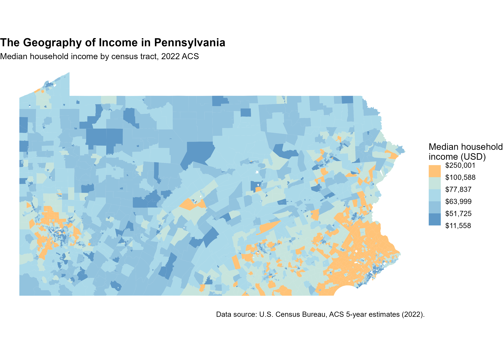
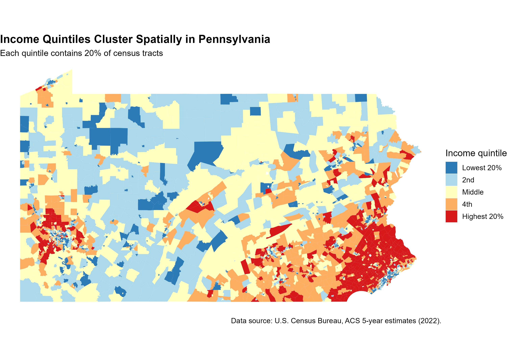
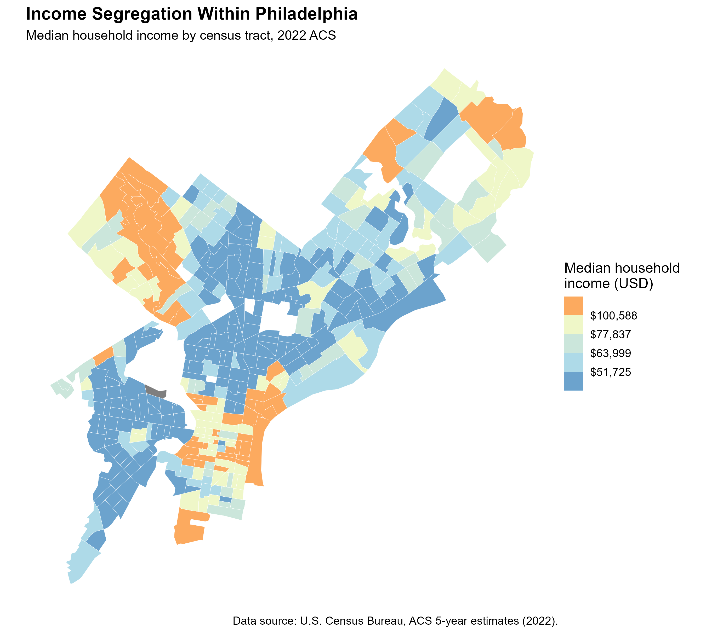

## Introduction

Where you live and how much you earn are closely connected.
In the United States, income is not distributed randomly across
space. High-income households cluster in certain neighborhoods,
low-income households cluster in others, and the boundary between
them is often sharp.

Pennsylvania is a useful place to study this pattern. It contains
two major metropolitan areas, Philadelphia and Pittsburgh, as
well as large stretches of rural land and older industrial towns.
If income is spatially concentrated, Pennsylvania should show it.

This analysis uses census tract data from the **American Community
Survey (ACS)** to map median household income across all 3,383
tracts in Pennsylvania. A census tract is a small geographic unit,
typically containing 1,200 to 8,000 people, which is small enough to
reveal neighborhood-level patterns that county or city averages
would hide.

The question this passage wants to answer is: **where are high-income and low-income areas
concentrated in Pennsylvania, and what does that pattern reveal
about economic geography?**

The answer turns out to be a story about scale. Income segregation
appears at three levels, the state, the metropolitan area, and
the neighborhood, and each level tells a different part of the
story.

## How I Measured It

I used data from the **2022 ACS 5-year estimates**, published by
the U.S. Census Bureau. The key variable is `B19013_001` —
median household income, in inflation-adjusted dollars.

**Why median.** Household income is strongly
right-skewed. A small number of very high earners pull the mean
far above the typical household. The median is less affected by
those extreme values, so it better represents what a typical
household earns.

**Why census tracts.** Counties and cities are too large to
capture neighborhood-level variation. For example, the county-level median income hides the fact that some neighborhoods are among the wealthiest in the state while
others are among the poorest. Census tracts reveal this
variation with more precise division.

**Data cleaning.** I removed tracts with missing income estimates
(62 tracts) and one tract with an empty geometry. The final
sample contains 3,383 tracts, covering all 67 counties in
Pennsylvania.

## Finding 1: Income Is Concentrated at the State Level

{width=90%}

The first map shows median household income for every tract in
Pennsylvania, colored by income quintile (each color contains
20% of tracts).

The pattern is clear. The **lowest-income tracts (dark blue)**
are concentrated in:
- **Center City Philadelphia** and its surrounding neighborhoods
- **Inner Pittsburgh**
- **Older industrial towns** such as Erie, Scranton, and Reading

The **highest-income tracts (orange and red)** are concentrated in:
- **Philadelphia's western suburbs** (the Main Line)
- **Pittsburgh's northern and eastern suburbs**
- **A few university towns** (State College, University Park)

The **middle of the state**, which is the large rural area between the
two metropolitan regions, is almost entirely middle-income
(yellow and light blue). There are less extreme values in these regions.

**What this means.** Income in Pennsylvania is not evenly
distributed across space. It is clustered into two main
high-income zones (the Philadelphia and Pittsburgh metro areas)
and a few smaller ones, surrounded by a large middle-income
rural region.

## Finding 2: Income Quintiles Cluster Spatially

{width=90%}

The second map isolates the top and bottom quintiles to make
the clustering more visible.

Two patterns stand out:

1. **High-income tracts (red) form a dense, contiguous block**
   in southeastern Pennsylvania, stretching from Philadelphia
   westward into Chester and Montgomery counties. This is a large and connected
   region of affluence rather than a
   scattering of rich neighborhoods.

2. **Low-income tracts (dark blue) also cluster**, but in
   different places: inner Philadelphia, inner Pittsburgh, and
   a string of smaller cities along the Susquehanna and
   Lehigh rivers.

**The key finding is that rich and poor tracts are adjacent to each other and form
coherent geographic regions.** The boundary between a red tract
and a blue tract is often a single street.

## Finding 3: Income Segregation Within Philadelphia

{width=90%}

The third map zooms into Philadelphia to show what income
segregation looks like at the neighborhood level.

The pattern is striking. **North Philadelphia and Kensington**, which are
the large sections of the city, are almost entirely dark blue
(bottom quintile). **Center City** is light green (middle
quintile, not top). **Chestnut Hill and parts of South
Philadelphia** are orange (top quintile).

So we could make several conclusions:

1. **Center City is not the richest part of the city.** Although many tall buildings are concentrated in this economic center, many students and
   renters are also living in the region. so the median household income is only in the middle quintile. The wealthiest tracts are in the northwest
   and along the southern edge.

2. **Low-income neighborhoods form a contiguous corridor**
   running north from Center City. It reflects decades of disinvestment,
   redlining, and the geography of public housing.

3. **High-income neighborhoods are small and separated.**
   Unlike the poor neighborhoods, which form large continuous
   areas, the wealthy neighborhoods are smaller and often
   isolated from each other by middle-income tracts.

## Conclusion

The spatial patterns in these three maps reveal three things
about economic geography in Pennsylvania:

**1. Income is not distributed randomly.** It clusters into
recognizable regions: some rich, some poor, most in between.
This clustering is visible at every scale, from the whole state
down to individual neighborhoods.

**2. Segregation is not just about income levels.** It is about
*spatial adjacency*. A state where rich and poor neighborhoods
are next to each other looks very different from a state where
they are separated by large middle-income buffers. For Pennsylvania, high-income regions concentrated in the
southeast and southwest, low-income regions concentrated in
inner cities and older industrial towns, and a vast middle-income
rural interior.

**3. Scale matters.** A county-level map would show Philadelphia
and Pittsburgh as relatively poor and their suburbs as relatively
rich. But the tract-level map shows that the story is more
complicated: within Philadelphia, some neighborhoods are among
the wealthiest in the state, and within the suburbs, some tracts
are middle-income. Aggregation hides these patterns.

**What should a reader take away?** The map is not just a picture
of where people live. It is a picture of opportunity — access to
good schools, safe streets, and high-paying jobs is distributed
unevenly across space, and the boundaries are often sharp. This
is the geography that policy has to work with.

## Limitations

- **ACS estimates are uncertain.** Each tract's median income has
  a margin of error, sometimes large. Small differences between
  adjacent tracts may not be statistically meaningful.
- **Median income is a crude measure.** It says nothing about
  wealth, cost of living, or household size. A tract with many
  retirees may have a low median income but high wealth.
- **2022 snapshot.** The data reflect one year. Income geography
  changes slowly, but the picture would differ in other years.
- **Tract boundaries can change.** Comparisons across years
  require attention to boundary changes.
- **Spatial patterns are not causal.** The maps show where income
  is concentrated, not why. Explanations require additional data
  and analysis.

---

*Data source: U.S. Census Bureau, American Community Survey
5-year estimates (2022), table B19013. Retrieved via the
`tidycensus` R package. Full code and data are available in the
[project repository](https://github.com/chelseacui0219-hue/blog5).*