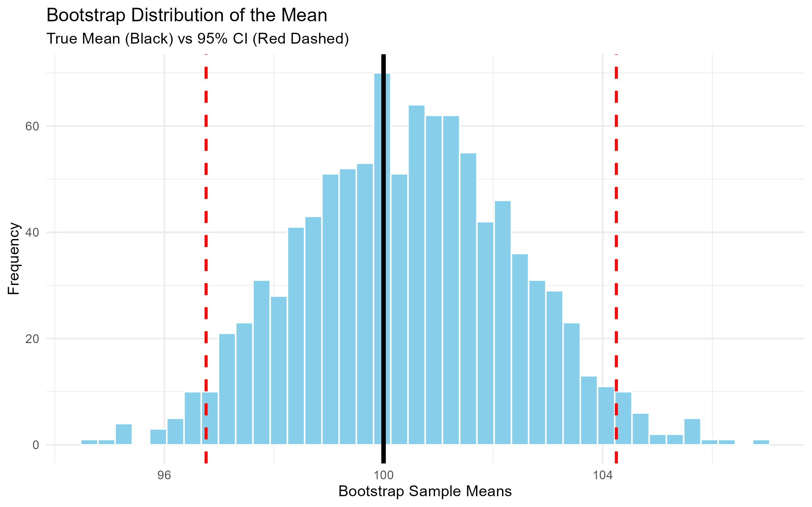
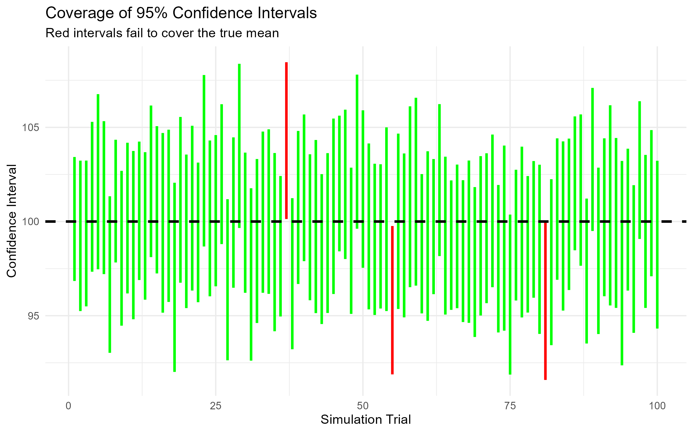
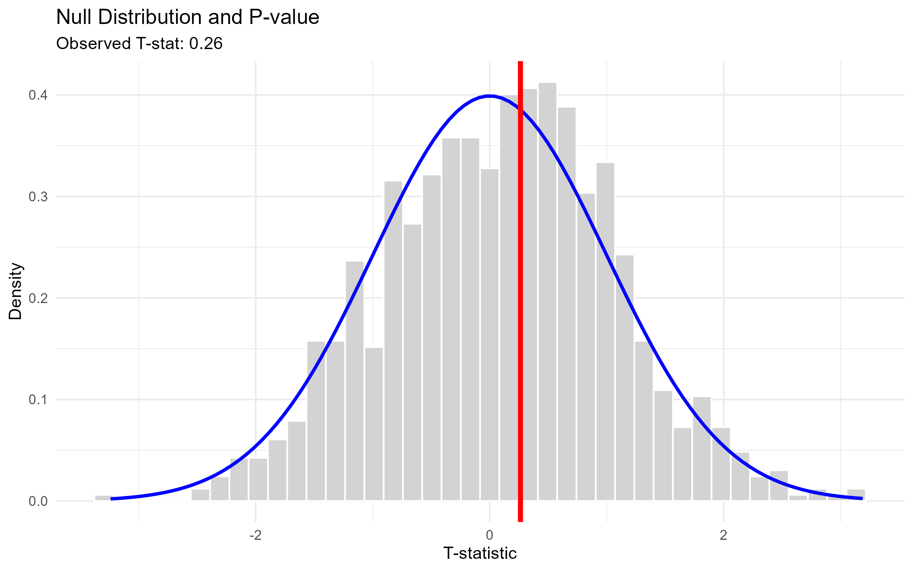

## Introduction

A 95% confidence interval does not mean there is a 95% probability that the true parameter lies within *this specific interval*. Instead, it is a statement about the long-run frequency of the procedure: if we were to repeat the experiment many times, approximately 95% of the intervals we construct would contain the true parameter. 

This post uses interactive simulations to illustrate three core statistical concepts: 
1. The Bootstrap method for constructing a confidence interval.
2. The concept of Coverage probability.
3. Hypothesis testing and the p-value.

## Part 1: The Bootstrap Method

Suppose we want to estimate the average height of students, but we only have one sample of size \(n\). The Bootstrap method allows us to estimate the sampling distribution by resampling with replacement from our observed data. 

By taking the 2.5th and 97.5th percentiles of the bootstrap distribution, we obtain a **percentile bootstrap confidence interval**. (Note: while percentile intervals are intuitive, more advanced methods like BCa intervals can be more robust when the bootstrap distribution is skewed).



**How to read the chart:**
- The **black solid line** is the true population mean (\(\mu = 100\)).
- The **light blue histogram** is the distribution of our 1,000 resampled means.
- The **red dashed lines** represent the 95% Confidence Interval. We find these by taking the 2.5th and 97.5th percentiles of the bootstrap distribution.

In the Shiny App, you can change the Confidence Level to 80% (the red lines will move closer together) or increase the number of simulations (the histogram will become smoother).

## Part 2: Coverage and Long-Run Frequency

To understand coverage, we simulate 100 different samples from a known population (with a true mean \(\mu\)). For each sample, we calculate a confidence interval and plot it.

> *Try re-running the simulation. The number of green lines will fluctuate slightly around 95—sometimes 93, sometimes 96. This is sampling variability.* 

Because we are using a 95% confidence level, **the expected number of intervals containing the true mean is 95**. However, in any finite number of trials (e.g., 100), the exact count is a random variable. It is not guaranteed to be exactly 95.

*Methodological Note*: To emphasize the concept of coverage itself, the simulation panel in the Shiny app below uses the analytical z-interval (\( \bar{x} \pm z \cdot \frac{s}{\sqrt{n}} \)) rather than calculating a bootstrap interval 100 times. The coverage concept applies equally to bootstrap intervals, but the z-interval keeps the visualization fast and computationally simple.



**How to read the chart:**
- Each horizontal line represents one experiment.
- **Green lines** are intervals that successfully captured the true mean (100).
- **Red lines** are the "failures" — intervals that missed the true mean.
- The dashed black line is the true mean.


## Part 3: Hypothesis Testing and the Null Distribution

Hypothesis testing flips the question: instead of estimating a parameter, we assume the null hypothesis \(H_0\) is true and ask how likely our observed data would be under that assumption.

In our simulation, we generate a null distribution by repeatedly drawing from a **known normal population** with \(\mu = 100\) and \(\sigma = 15\) (our "true" parameters). For each simulated sample, we calculate the t-statistic. 

*(Note: This is a parametric simulation. In real-world data analysis, where the population parameters are unknown, we would not be able to do this and would have to rely on theoretical t-distributions or non-parametric methods.)*

The p-value is the probability of observing a t-statistic as extreme as our actual data, assuming \(H_0\) is true. Visually, this visualization shows the one-sided right-tail p-value: it corresponds to the area under the curve to the right of the red line (the observed t-statistic). The Shiny app overlays the theoretical t-distribution curve to show how the simulated null distribution approximates it.



**How to read the chart:**
- The **light gray histogram** is the distribution of T-statistics under the null hypothesis. 
- The **red vertical line** is the T-statistic we actually observed from our sample.
- The **p-value** is the probability of getting a T-statistic as extreme as our red line, assuming the null hypothesis is true. Visually, it is the area under the curve to the right of the red line.

If the red line is far into the tail of the distribution, the p-value is small, and we reject the null hypothesis.

## Conclusion

Simulation strips away the mystery of statistical inference. 

1. **Bootstrap** shows us how to construct confidence intervals without assuming a theoretical distribution.
2. **Coverage simulations** illustrate that a 95% confidence interval is a property of the *procedure*, not a single interval.
3. **Null distributions** make p-values visual, showing exactly how rare our observed data would be if the null hypothesis were true.

## Appendix: Interactive Shiny App Code

Below is the complete R code for the interactive Shiny application. If you have R installed, you can run this code locally to explore how changing the sample size, number of simulations, and confidence level affects the results.

```r
library(shiny)
library(plotly)
library(tidyverse)

ui <- fluidPage(
  titlePanel("Interactive Statistical Inference Demo"),
  sidebarLayout(
    sidebarPanel(
      sliderInput("n", "Sample Size (n):", min = 10, max = 200, value = 50),
      sliderInput("sims", "Number of Bootstrap Simulations:", min = 100, max = 2000, value = 1000, step = 100),
      sliderInput("conf", "Confidence Level:", min = 0.80, max = 0.99, value = 0.95, step = 0.01),
      actionButton("resample", "Draw New Sample")
    ),
    mainPanel(
      tabsetPanel(
        tabPanel("1. Bootstrap Distribution", plotlyOutput("boot_plot")),
        tabPanel("2. CI Coverage (Simulations)", plotlyOutput("coverage_plot")),
        tabPanel("3. Hypothesis Testing", plotlyOutput("test_plot"))
      )
    )
  )
)

server <- function(input, output, session) {
  true_mean <- 100
  true_sd <- 15
  
  sample_data <- eventReactive(input$resample, {
    rnorm(input$n, mean = true_mean, sd = true_sd)
  }, ignoreNULL = FALSE)
  
  output$boot_plot <- renderPlotly({
    data <- sample_data()
    boot_means <- replicate(input$sims, mean(sample(data, replace = TRUE)))
    alpha <- (1 - input$conf) / 2
    ci <- quantile(boot_means, probs = c(alpha, 1 - alpha))
    df <- data.frame(boot_means = boot_means)
    
    p <- ggplot(df, aes(x = boot_means)) +
      geom_histogram(bins = 40, fill = "skyblue", color = "white") +
      geom_vline(xintercept = ci[1], color = "red", linetype = "dashed", linewidth = 1) +
      geom_vline(xintercept = ci[2], color = "red", linetype = "dashed", linewidth = 1) +
      geom_vline(xintercept = true_mean, color = "black", linewidth = 1.5) +
      labs(title = "Bootstrap Distribution of the Mean",
           subtitle = paste("True Mean vs ", input$conf*100, "% CI"),
           x = "Bootstrap Sample Means", y = "Frequency") +
      theme_minimal()
    ggplotly(p)
  })
  
  output$coverage_plot <- renderPlotly({
    trials <- 100
    ci_df <- data.frame(trial = 1:trials, lower = numeric(trials), upper = numeric(trials), covers = logical(trials))
    alpha <- (1 - input$conf) / 2
    
    for(i in 1:trials) {
      x <- rnorm(input$n, mean = true_mean, sd = true_sd)
      m <- mean(x)
      se <- sd(x) / sqrt(input$n)
      z <- qnorm(1 - alpha)
      ci_df$lower[i] <- m - z * se
      ci_df$upper[i] <- m + z * se
      ci_df$covers[i] <- (true_mean >= ci_df$lower[i]) & (true_mean <= ci_df$upper[i])
    }
    
    p <- ggplot(ci_df, aes(x = trial, ymin = lower, ymax = upper, color = covers)) +
      geom_linerange(linewidth = 1) +
      geom_hline(yintercept = true_mean, linetype = "dashed", color = "black", linewidth = 1) +
      scale_color_manual(values = c("TRUE" = "green", "FALSE" = "red"), guide = "none") +
      labs(title = "Coverage of Confidence Intervals",
           x = "Simulation Trial", y = "Confidence Interval") +
      theme_minimal()
    ggplotly(p)
  })
  
  output$test_plot <- renderPlotly({
    x <- sample_data()
    obs_t <- (mean(x) - true_mean) / (sd(x) / sqrt(input$n))
    null_t <- replicate(input$sims, {
      x_null <- rnorm(input$n, mean = true_mean, sd = true_sd)
      (mean(x_null) - true_mean) / (sd(x_null) / sqrt(input$n))
    })
    df <- data.frame(null_t = null_t)
    
    # 稳健的边界计算，防止 obs_t 过大导致画图报错
    upper_xlim <- max(max(null_t), obs_t + 1)
    
    p <- ggplot(df, aes(x = null_t)) +
      geom_histogram(bins = 40, fill = "lightgray", color = "white", aes(y = after_stat(density))) +
      stat_function(
        fun = dt, 
        args = list(df = input$n - 1), 
        geom = "area", 
        fill = "red", 
        alpha = 0.3, 
        xlim = c(obs_t, upper_xlim) 
      ) +
      stat_function(fun = dt, args = list(df = input$n - 1), color = "blue", linewidth = 1) +
      geom_vline(xintercept = obs_t, color = "red", linewidth = 1.5) +
      labs(title = "Null Distribution and P-value (One-sided Right Tail)",
           x = "T-statistic", y = "Density") +
      theme_minimal()
    ggplotly(p)
  })
}

shinyApp(ui, server)