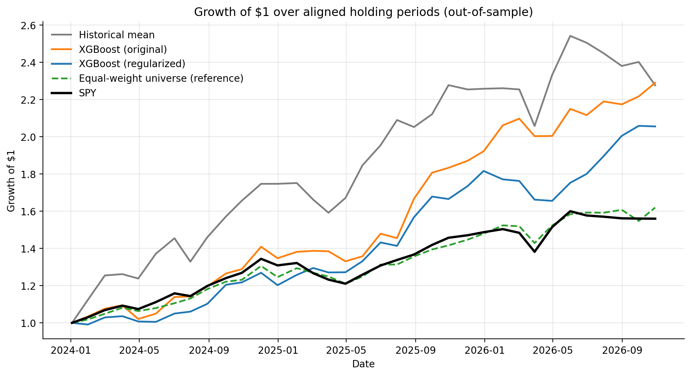
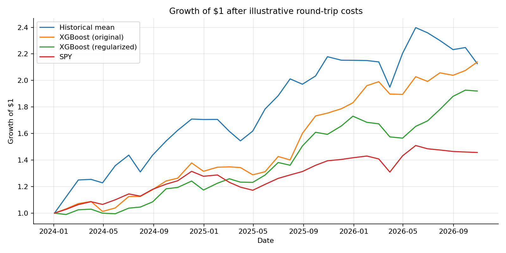

---
title: "Blog9: Predicting Stock Returns with Gradient Boosting: Does a Simpler Model Perform Better?"
author: "Yuzhuo Cui"
date: "2026-11-06"
format:
  html:
    toc: true
    code-fold: false
---

## Introduction

Predicting stock returns sounds like an ideal task for machine learning. If a model can identify patterns in historical prices, perhaps it can help investors choose better stocks. However, financial markets are noisy, and patterns that appear in historical data do not necessarily continue into the future.

In this experiment, I revisit the XGBoost stock prediction model from class and investigate a simple question: **Can reducing model complexity improve prediction accuracy, and will better predictions lead to higher investment returns?**

## The Original Experiment

In class, we used XGBoost, a gradient boosting algorithm, to predict future stock returns using historical market data. The dataset includes approximately 95 large U.S. companies across different industries, with daily stock prices obtained from Yahoo Finance.

The model uses information such as past returns, momentum, volatility, and trading volume. It combines 300 decision trees, each attempting to correct the errors of previous trees, with a maximum tree depth of five and a learning rate of 0.05.

The goal is to predict returns over approximately one trading month. Based on these predictions, stocks are ranked, and the ten with the highest expected returns are selected for a portfolio. The portfolio's performance is then compared with SPY, an ETF tracking the S&P 500.

The classroom experiment demonstrated how machine learning predictions could be translated into investment decisions. However, it also raised an important question: does a profitable backtest indicate genuine predictive ability, or could it simply reflect patterns specific to the historical sample?

## Improving the Model

One potential problem with gradient boosting is overfitting. Because financial returns contain substantial random variation, a complex model may learn patterns that do not generalize to new data.

To investigate this, I tested a more regularized XGBoost model. The improved model uses stronger constraints on tree complexity, with hyperparameters selected through walk-forward validation using training data only.

I retained the original prediction task and compared four approaches: the original XGBoost model, the regularized XGBoost model, a benchmark based on historical average returns, and a zero-return forecast.

The models were trained using historical observations before 2024 and evaluated on out-of-sample data beginning in 2024. Training observations whose future-return windows crossed into the test period were excluded to reduce look-ahead bias.

## Prediction Results

I evaluated prediction accuracy using root mean squared error (RMSE), mean absolute error (MAE), and the correlation between predicted and actual returns.

| Model | RMSE | MAE | Correlation |
|:---|---:|---:|---:|
| Historical mean | 0.0891 | 0.0647 | 0.0473 |
| Original XGBoost | 0.0934 | 0.0682 | 0.0307 |
| **Regularized XGBoost** | **0.0884** | **0.0640** | **0.0719** |
| Zero return | 0.0895 | 0.0644 | N/A |

: Out-of-sample prediction performance. Lower RMSE and MAE indicate better accuracy.

The regularized model achieved the lowest RMSE and MAE, reducing RMSE by approximately 5.4% compared with the original model. It also slightly outperformed both simple benchmarks.

However, its prediction correlation was only 0.0719. Although regularization improved forecasting accuracy, the relationship between predictions and actual returns remained extremely weak.

This illustrates a fundamental difficulty in financial prediction: reducing overfitting does not necessarily reveal a strong or stable predictive signal.

## From Predictions to Investment Returns

To investigate whether these predictions were economically useful, I compared the performance of portfolios constructed from the model forecasts. The backtest included 34 non-overlapping holding periods beginning in 2024.

{fig-align="center" width="100%"}

I also conducted a sensitivity analysis assuming transaction costs of 0.1% on each purchase and sale.

| Strategy | Gross cumulative return | Net cumulative return | Net Sharpe |
|:---|---:|---:|---:|
| Historical mean | 127.64% | 112.67% | 1.20 |
| **Original XGBoost** | **128.98%** | **113.92%** | **1.57** |
| Regularized XGBoost | 105.53% | 92.01% | 1.50 |
| SPY | 55.97% | 45.71% | 0.90 |

: Portfolio performance across 34 holding periods. Sharpe ratios use Treasury-bill rates as the risk-free benchmark.

{fig-align="center" width="100%"}

Interestingly, the original XGBoost portfolio produced higher cumulative returns and a higher Sharpe ratio than the regularized model, despite having worse prediction accuracy.

One possible explanation is that RMSE measures average forecasting errors across all stocks, while portfolio returns depend primarily on selecting the best-performing stocks. A model can make more accurate predictions overall without identifying the most profitable investments.

Another interesting result is that the historical-mean strategy also substantially outperformed SPY. This suggests that the strong portfolio returns cannot necessarily be attributed to sophisticated machine learning.

Although the XGBoost portfolios remained profitable after assumed transaction costs, these results should be interpreted cautiously. The backtest uses a fixed stock universe, potentially introducing survivorship bias, and does not fully account for liquidity, market impact, or changing market conditions.

The transaction-cost analysis also assumes complete buying and selling each period, including for SPY. This makes it a standardized sensitivity test rather than a realistic comparison with a passive buy-and-hold SPY investment.

## Takeaway

This experiment shows that reducing model complexity can improve out-of-sample prediction accuracy, but better forecasts do not necessarily generate better investment returns.

The regularized model achieved lower prediction errors, while the original model produced stronger portfolio performance. More importantly, the predictive relationships remained weak, and even simple strategies generated substantial historical returns.

I learned that evaluating financial machine learning requires looking beyond prediction accuracy or cumulative returns alone. A successful backtest is not sufficient evidence that a model can reliably predict the stock market.

## Data and Reproducibility

**Data source:** [Yahoo Finance](https://finance.yahoo.com/), including historical stock prices and market benchmarks.

**Reproducibility:** The analysis notebook and supporting files are available in the project's GitHub repository.
